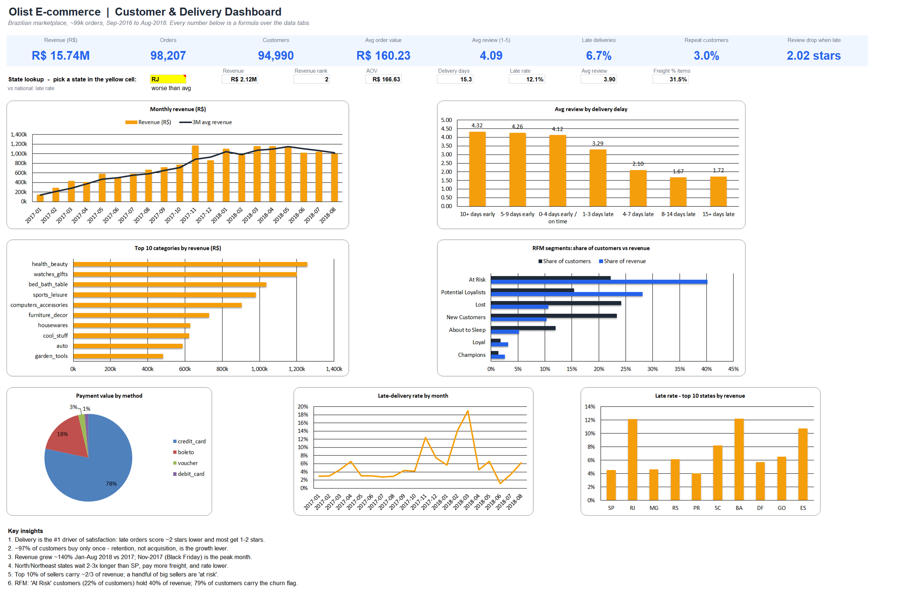
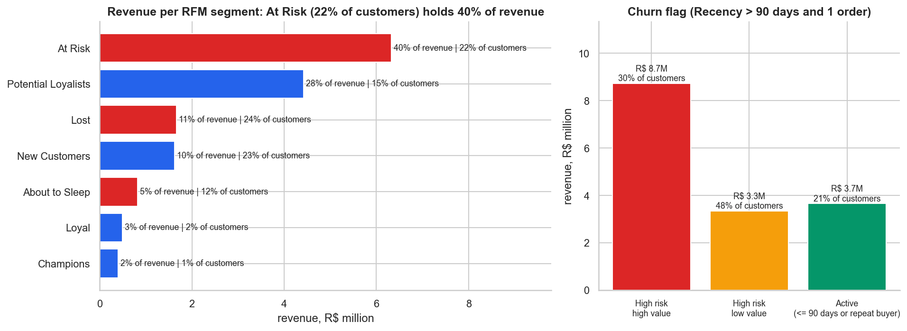
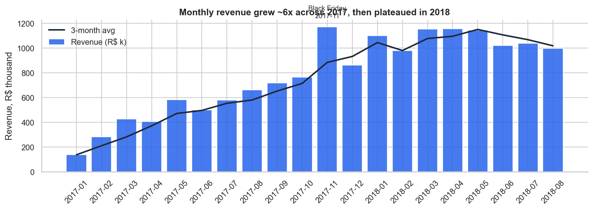
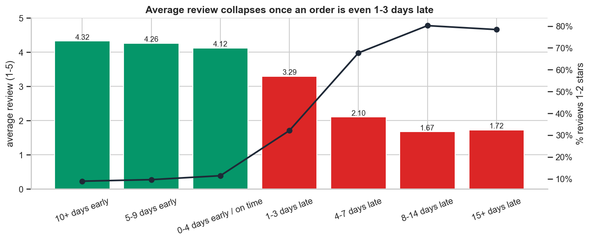
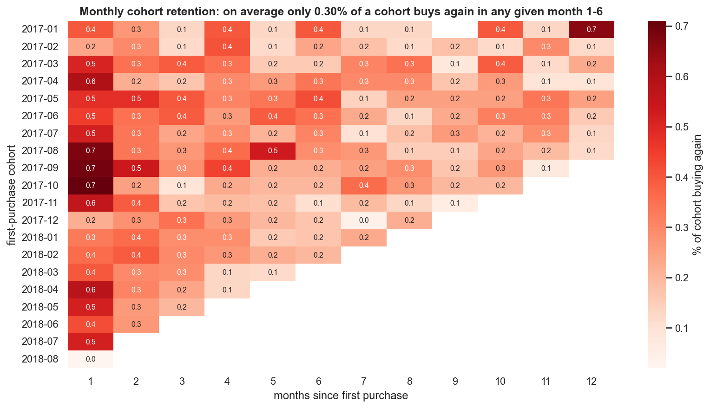
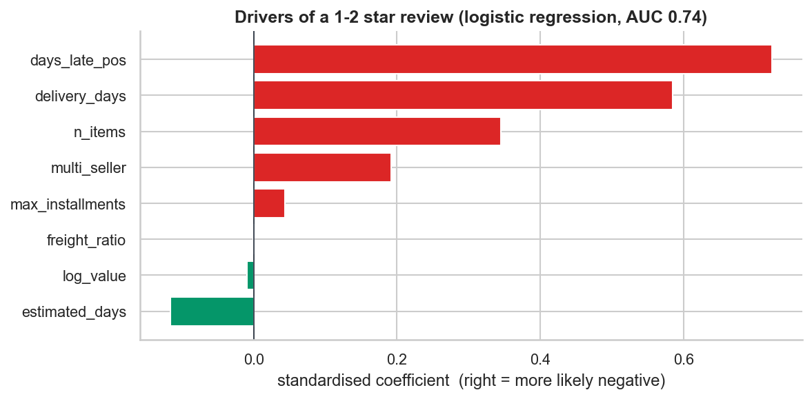
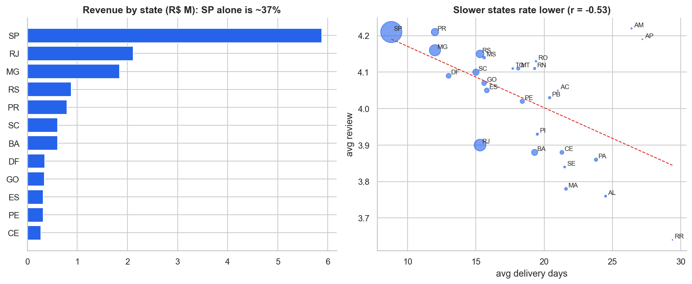
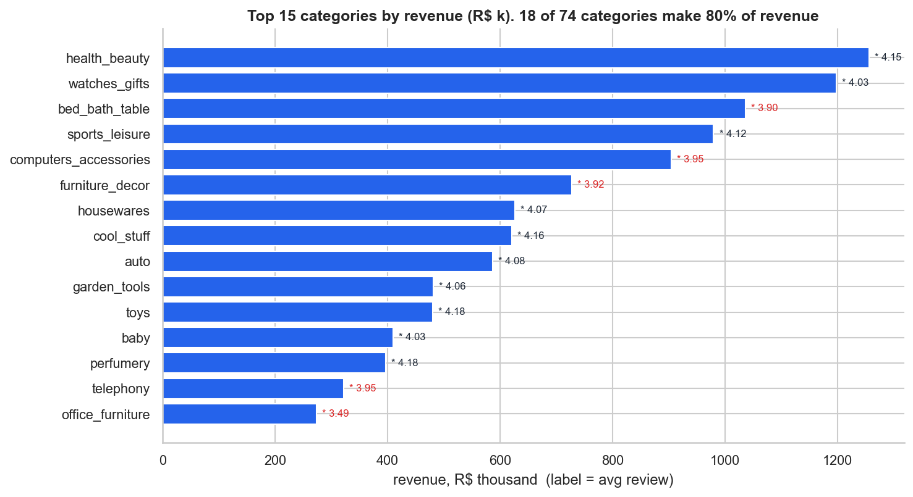
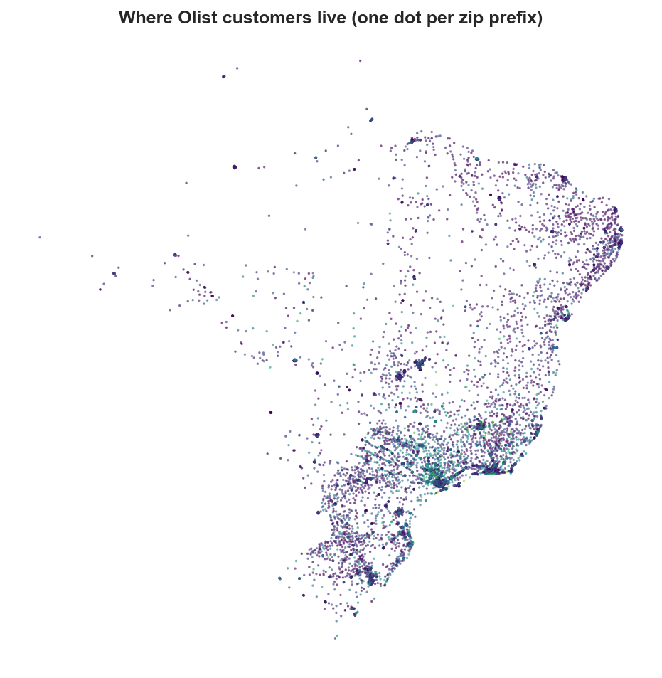
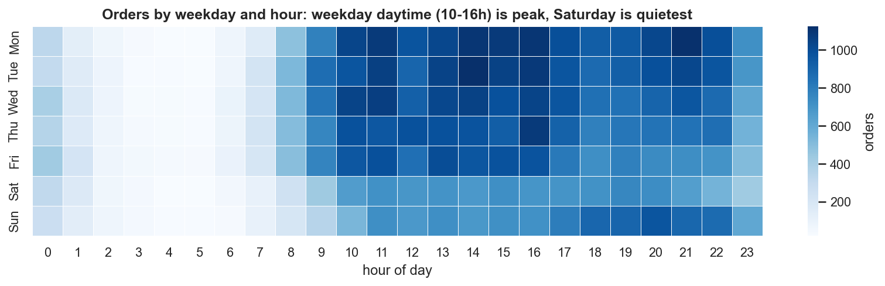

# Olist E-commerce: Customer, Delivery & Retention Analytics

     

**SQL · Python · Excel** end-to-end analysis of ~100k real orders from Olist, a Brazilian online marketplace (Sep 2016 to Aug 2018, 9 linked tables).

> **The headline:** delivery is what drives satisfaction. A late order averages **2.27 stars** vs **4.29** on time, and **62%** of late orders get a 1-2 star review. On top of that, **97% of customers never buy a second time**, so growth has been bought through acquisition, not loyalty.



---

## Business questions

1. How is the business growing, and when do customers buy?
2. Do customers come back? Which customers are worth the most (RFM)?
3. What causes bad reviews: the product or the delivery?
4. Which states, categories and sellers need attention?

## Headline numbers

| Metric | Value |
|---|---|
| Orders (excl. canceled/unavailable) | 98,207 |
| Unique customers | 94,990 |
| Gross revenue (items + freight) | R$ 15.74M |
| Average order value | R$ 160 |
| Delivered late (vs promised date) | 6.8% |
| Average review | 4.12 / 5 |
| Customers with 2+ orders | 3.0% |
| Revenue growth, Jan-Aug 2018 vs Jan-Aug 2017 | +140% |

## Key findings and recommendations

| # | Finding | Evidence | Recommendation |
|---|---|---|---|
| 1 | **Late delivery destroys ratings.** Even 1-3 days late drops the average from 4.1 to 3.3; 4+ days late, 68-80% of reviews are 1-2 stars. | `review_by_delivery_delay`; Mann-Whitney p < 0.001; days late is the strongest driver in a logistic model (AUC 0.74) | Pad delivery estimates in slow lanes, send proactive delay alerts, and rank sellers by on-time rate. |
| 2 | **Almost no repeat business.** 97% of customers order once; in any month only ~0.3% of a cohort buys again. | `repeat_purchase_distribution`, `cohort_retention` | Second-order programme: a post-delivery coupon within 30 days, category-based reminders. Every +1pp in repeat rate is about 950 extra orders, or roughly R$ 150k. |
| 3 | **At Risk customers hold the most revenue.** "At Risk" (22% of customers) holds **40% of revenue**, and with "Potential Loyalists" (15%, 28%), 38% of customers make up 68% of revenue. **79% of customers** carry the churn flag (1 order, > 90 days silent). | `sql/05_rfm_segmentation.sql`, [1-page recommendation](reports/RFM_recommendation.md) | Value-ranked win-back for the 29,006 high-value flagged customers (55% of revenue); second-order programme for new buyers. |
| 4 | **Multi-seller orders rate much lower** (2.86 vs 4.17), since they arrive as separate parcels. | `multi_seller_orders` | Consolidate shipments or set expectations at checkout. |
| 5 | **The North and Northeast are underserved.** AL, MA, SE, CE and PA wait 21-25 days (SP: 9), pay freight worth 43-54% of the item price, and rate lowest. | `customers_by_state` | Regional fulfilment hubs and carriers; freight subsidies on high-value categories. |
| 6 | **Seller revenue is concentrated.** The top 10% of sellers carry 68% of revenue. 38 sellers with 50+ orders are "at risk" (rating < 3.5 or > 15% late). | `seller_concentration`, `seller_scorecard` | Coach or demote at-risk sellers; protect star sellers. |
| 7 | **Late-delivery spikes** came in Nov-2017 (Black Friday) and Feb-Mar 2018 (up to ~19% late). | `monthly_trend` | Add carrier capacity before Q4 and the post-Carnival period. |

## What each tool does

| Layer | Files | What it shows |
|---|---|---|
| **Python ETL** | [`src/etl.py`](src/etl.py) | Loads 9 CSVs, fixes types, deduplicates reviews, translates categories, collapses 1M geolocation rows to one point per zip code, builds a **SQLite** database with indexes, and writes a [data-quality report](outputs/data_quality_report.csv). |
| **SQL** | [`sql/`](sql) (25 queries) | Analytical views (order-grain fact view), **CTEs**, **window functions** (`LAG`, moving averages, running totals, `RANK`, `NTILE`, `PERCENT_RANK`), cohort retention, RFM base, Pareto, seller segmentation with `CASE`. Run by [`src/run_sql.py`](src/run_sql.py), and results land in [`outputs/sql_results/`](outputs/sql_results). |
| **Python analysis** | [`notebooks/olist_analysis.ipynb`](notebooks/olist_analysis.ipynb) (source [`src/analysis.py`](src/analysis.py)) | RFM segmentation with actions, cohort heatmap, a statistical test (Mann-Whitney U), a logistic-regression driver model for negative reviews, a state regression, a customer map, and 9 charts. |
| **Excel** | [`excel/Olist_Customer_Dashboard.xlsx`](excel/Olist_Customer_Dashboard.xlsx) | One-page dashboard with KPI tiles, 7 native charts, and an **interactive state lookup** (dropdown + `INDEX/MATCH`). Data tabs use Excel Tables, **430+ live formulas** (`SUMIFS`, `COUNTIFS`, `AVERAGEIFS`, `SUMPRODUCT`, `RANK`, MoM growth, running totals, Pareto classes), and conditional formatting (data bars, colour scales). |

## RFM segmentation and churn risk

**Business question:** which customer segments generate the most revenue, and which are at risk of churning?

| Deliverable | File |
|---|---|
| SQL script with the RFM calculations, segment labels and churn flag | [`sql/05_rfm_segmentation.sql`](sql/05_rfm_segmentation.sql) |
| Excel segment summary, revenue-per-segment chart, churn tiers and cut-offs | `RFM_Segments` tab in [`excel/Olist_Customer_Dashboard.xlsx`](excel/Olist_Customer_Dashboard.xlsx) |
| Bar chart: revenue per segment and churn tiers | [`reports/figures/04_rfm_segments.png`](reports/figures/04_rfm_segments.png) |
| 1-page written recommendation | [`reports/RFM_recommendation.md`](reports/RFM_recommendation.md) |



**How it avoids the usual mistakes**
- **Customer level, not order level:** every metric is aggregated per `customer_unique_id`. In Olist, `customer_id` is re-issued for every order, so grouping by it would turn every order into a "customer".
- **Thresholds come from the data:** R and M scores are `NTILE(5)` quintiles. The actual cut-offs are published by the `rfm_cutoffs` query: Recency 99 / 183 / 274 / 389 days, Monetary R$ 55 / 88 / 133 / 209. F uses business logic (1 / 2 / 3+ orders) because 97% of customers buy once.
- **Findings, not descriptions:** "At Risk (22% of customers) holds 40% of revenue", not "At Risk customers spend a lot".
- **Cleaned first:** canceled and unavailable orders and orders with no items are removed. Recency is measured from the day after the last *valid* order (2018-09-04).

**Churn flag (stretch goal):** `Recency > 90 days AND Frequency = 1` flags 79.0% of customers (76.8% of revenue). The data ends in 2018 and almost nobody buys twice, so the flag alone is too broad. It is therefore split by value: **29,006 high-value flagged customers (M score 4-5) hold R$ 8.73M, 55.5% of all revenue**, and they are the priority list.

## Data
The 9 original CSVs are in [`data/raw/`](data/raw), unchanged.
Source: [Brazilian E-Commerce Public Dataset by Olist (Kaggle)](https://www.kaggle.com/datasets/olistbr/brazilian-ecommerce), CC BY-NC-SA 4.0.

| File | Rows |
|---|---:|
| `olist_orders_dataset.csv` | 99,441 |
| `olist_customers_dataset.csv` | 99,441 |
| `olist_order_items_dataset.csv` | 112,650 |
| `olist_order_payments_dataset.csv` | 103,886 |
| `olist_order_reviews_dataset.csv` | 99,224 |
| `olist_products_dataset.csv` | 32,951 |
| `olist_sellers_dataset.csv` | 3,095 |
| `product_category_name_translation.csv` | 71 |
| `olist_geolocation_dataset.csv` | 1,000,163 |

## Data model

```
customers (customer_id, customer_unique_id) 1──* orders 1──* order_items *──1 products ── category_translation
                                                  │  1──* payments        *──1 sellers
                                                  └─ 1──1 reviews (deduplicated)
geolocation (zip prefix -> lat/lng) joins customers and sellers
```
`customer_id` is created per order. The real person is `customer_unique_id`, so every retention metric uses that key. Mixing them up is a common mistake with this dataset, and it would make the repeat rate look like 0%.

## Data cleaning

All cleaning happens in [`src/etl.py`](src/etl.py). The original files in [`data/raw/`](data/raw) are never modified. The cleaned tables are written both to the SQLite database and as CSV files in [`data/cleaned/`](data/cleaned), so you can open them directly in Excel or pandas. Every check is also logged in [`outputs/data_quality_report.csv`](outputs/data_quality_report.csv) and the `Data_Quality` tab of the workbook.

### Raw data at a glance

| File | Rows | Key | Issues found |
|---|---:|---|---|
| `olist_customers_dataset.csv` | 99,441 | `customer_id` | Only 96,096 real people; untidy city names |
| `olist_orders_dataset.csv` | 99,441 | `order_id` | 4,908 missing timestamps; 8 "delivered" orders with no delivery date |
| `olist_order_items_dataset.csv` | 112,650 | `order_id` + `order_item_id` | 775 orders have no items |
| `olist_order_payments_dataset.csv` | 103,886 | `order_id` + `payment_sequential` | 3 rows `not_defined`; split payments |
| `olist_order_reviews_dataset.csv` | 99,224 | `review_id` | 814 duplicate ids; 547 orders with >1 review |
| `olist_products_dataset.csv` | 32,951 | `product_id` | 610 without category; misspelled column names |
| `olist_sellers_dataset.csv` | 3,095 | `seller_id` | Untidy city names |
| `product_category_name_translation.csv` | 71 | `product_category_name` | 2 categories missing; BOM at start of file |
| `olist_geolocation_dataset.csv` | 1,000,163 | none | 261,831 exact duplicates; 42 points outside Brazil |

### Cleaning summary, file by file

| File | Problem found | What was done |
|---|---|---|
| **customers** | 99,441 `customer_id`s but only 96,096 real people: a new id is created for every order. | All customer and retention numbers use `customer_unique_id`. Without this, nobody would ever look like a repeat buyer. City names trimmed and title-cased. |
| **orders** | Missing dates: 160 approval, 1,783 handed to carrier, 2,965 delivered. 8 orders say "delivered" but have no delivery date. | Text dates converted to real dates. An order counts as delivered only if its status is `delivered` **and** it has a date. Added `delivery_days`, `estimated_days`, `days_late` (vs the promised date), `is_late` and `purchase_month`. |
| **order_items** | 775 orders (mostly canceled or unavailable) have no items. | Kept, but they add no revenue. Revenue = item price + freight, excluding canceled and unavailable orders. |
| **payments** | 3 rows with type `not_defined`. Some orders are split across several payments. | The 3 rows are removed. Payments are summed per order, and the method carrying the largest amount is recorded as the main one. |
| **reviews** | 814 duplicate `review_id`s; 547 orders with more than one review. 58k reviews have no text comment (normal). | Kept the latest review per order, leaving 98,673. Added a `has_comment` flag. |
| **products** | 610 products with no category. 2 categories missing from the translation file. Misspelled column names (`lenght`). | Missing categories set to `unknown`. Translated `pc_gamer` and `portateis_cozinha...` by hand. Fixed the column names. |
| **category translation** | The file starts with an invisible character (BOM). | Read with `utf-8-sig` so the first column name comes through correctly. |
| **sellers** | Untidy city names | Trimmed and title-cased |
| **geolocation** | 1,000,163 rows: 261,831 exact duplicates, 42 points outside Brazil, many points per zip code | Points outside Brazil removed, then averaged to one point per zip code, leaving 19,010 rows. Used for the customer map. |
| **all files** | Zip codes like `01037` lose their leading zero when read as numbers. | Read as text. |
| **time range** | Sep-Dec 2016 and Sep-Oct 2018 have very few orders. | Trend charts use Jan 2017 to Aug 2018 only. |

### Step by step

**1. Read everything with the right types**
- Zip code prefixes (`01037`) are read as **text**, so leading zeros are not lost.
- All date columns (purchase, approval, carrier, delivery, estimated delivery, shipping limit, review dates) are parsed into real datetimes; unparseable values become null instead of failing.
- The translation file starts with an invisible byte-order mark, so it is read with `utf-8-sig` to keep the first column name correct.

**2. Customers: separate the order id from the person**
- `customer_id` is generated **per order** (99,441 ids), while `customer_unique_id` is the real person (96,096).
- Every customer, repeat-purchase, cohort and RFM metric uses `customer_unique_id`. Using `customer_id` would make every customer look like a one-time buyer.
- City names trimmed and title-cased (`sao paulo` to `Sao Paulo`).

**3. Orders: define "delivered" and add delivery metrics**
- Missing timestamps are left as null, not filled in: 160 approval dates, 1,783 carrier dates and 2,965 customer delivery dates. Most belong to canceled, unavailable or in-transit orders.
- An order counts as **delivered** only if its status is `delivered` **and** it has a delivery date. That excludes 8 inconsistent orders.
- New columns:
  - `delivery_days`: purchase to delivery
  - `estimated_days`: purchase to promised date
  - `days_late`: delivery date minus promised date, in whole days (positive = late)
  - `is_late`: set only for delivered orders
  - `purchase_month`: for trends and cohorts

**4. Order items: define revenue**
- Revenue = item `price` + `freight_value`, summed per order.
- Canceled and unavailable orders are excluded from revenue and KPIs. The 775 orders with no items (almost all canceled or unavailable) therefore add nothing.
- Category-level revenue uses item price only, without freight.

**5. Payments**
- 3 rows with `payment_type = not_defined` removed.
- Orders paid with several methods (for example card + voucher) are summed per order. The method carrying the largest amount is recorded as the order's main payment type, along with the maximum number of installments.

**6. Reviews: one review per order**
- 814 `review_id`s appear more than once, and 547 orders have more than one review.
- Kept the **most recent answer per order**, leaving 98,673 reviews, so no order is double-counted in review averages.
- 58,247 reviews have no text comment. That is normal (the score is mandatory, text is optional), so a `has_comment` flag is added instead of dropping them.

**7. Products and categories**
- Misspelled source columns fixed: `product_name_lenght` and `product_description_lenght` become `..._length`.
- 2 Portuguese categories missing from the translation file were translated by hand:
  - `pc_gamer` becomes `pc_gamer`
  - `portateis_cozinha_e_preparadores_de_alimentos` becomes `portable_kitchen_food_processors`
- 610 products with no category are labelled `unknown`, not dropped, so their sales still count.
- The English name is joined onto every product as a single `category` column, so SQL never has to deal with Portuguese names.
- 2 products with no weight or dimensions are kept, since those columns aren't used in the analysis.

**8. Sellers**
- City names trimmed and title-cased.

**9. Geolocation: 1M rows down to one point per zip code**
- The raw file has many GPS points per zip prefix, including 261,831 exact duplicates.
- Points outside Brazil's bounding box are removed: latitude -34 to 5.5, longitude -74 to -34. That drops 42 points.
- Remaining points are averaged into **one lat/lng per zip prefix**, leaving 19,010 rows. These are used for the customer map. The state is taken from the first point for each zip.

**10. Load into SQLite**
- 8 clean tables written to `data/olist.db` **and** to `data/cleaned/*.csv` (customers, orders, order_items, payments, reviews, products, sellers, geolocation), with 12 indexes in the database on the join keys (order, customer, product, seller, zip) so the SQL layer runs in seconds.
- Dates are stored as `YYYY-MM-DD HH:MM:SS` text, the format SQLite's date functions (`DATE`, `strftime`, `julianday`) expect.
- The data-quality report is measured on the **raw** files, before any cleaning, so it shows the problems as they arrived.

**11. Checks that found nothing to fix**
- No duplicate keys in customers, orders, order items, payments, products or sellers.
- No fully duplicated rows in any table except geolocation.
- 9 payments of R$ 0.00 are vouchers, not errors, so they are kept.

**12. Analysis-level rules (in SQL and Python)**
- **Which orders count:** revenue, KPIs, customer and category metrics exclude `canceled` and `unavailable` orders.
- **Delivery metrics** (delivery days, late rate, review vs delay) use delivered orders only.
- **Review metrics** use only orders that have a review.
- **No divide-by-zero:** freight-to-price ratios use `NULLIF(price, 0)` in SQL and `replace(0, NaN)` in Python.
- **RFM** includes only customers whose orders have items (94,983 people). Recency is measured from the day after the last *valid* order (reference date 2018-09-04).
- **Review-driver model:** rows missing any model input are dropped before training.
- **Time window:** Sep-Dec 2016 and Sep-Oct 2018 have very few orders, so trend and cohort charts use **Jan 2017 to Aug 2018**.
- **Like-for-like growth:** year-on-year comparisons use Jan-Aug of both years.
- **Same-day "second orders":** 896 customers placed a second order on the same day as their first. These are probably split checkouts rather than true loyalty, so the 3% repeat rate is, if anything, slightly optimistic.

## SQL analysis

All SQL runs on the SQLite database built by the ETL. [`src/run_sql.py`](src/run_sql.py) executes the files in [`sql/`](sql) in order and saves each named query's result to [`outputs/sql_results/`](outputs/sql_results).

```bash
python src/run_sql.py
```

| File | Queries |
|---|---|
| [`00_views.sql`](sql/00_views.sql) | Reusable views: `v_orders` (one row per order with value, payment, review and delivery fields) and `v_items` (one row per item with category and seller) |
| [`01_business_kpis.sql`](sql/01_business_kpis.sql) | KPI summary, monthly trend (MoM growth, 3-month average, running total), order status mix, weekday x hour heatmap, payment mix, installments vs order value |
| [`02_customers_retention.sql`](sql/02_customers_retention.sql) | Repeat-purchase distribution, days to second order, monthly cohort retention, performance by state |
| [`03_delivery_reviews.sql`](sql/03_delivery_reviews.sql) | Review score by delivery delay, review distribution, late vs on time, multi-seller orders, worst seller-to-customer routes |
| [`04_products_sellers.sql`](sql/04_products_sellers.sql) | Category Pareto, category growth 2018 vs 2017, seller scorecard and segments, seller revenue concentration |
| [`05_rfm_segmentation.sql`](sql/05_rfm_segmentation.sql) | Customer-level RFM table, data-driven cut-offs, segment labels (Champions, Loyal, Potential Loyalists, New Customers, At Risk, About to Sleep, Lost), segment summary, churn flag and value-ranked churn tiers, At Risk revenue by state |

**Techniques used:** multi-table joins, views, CTEs, `CASE` bucketing, window functions (`LAG`, moving averages, running totals, `RANK`, `NTILE`, `PERCENT_RANK`, `ROW_NUMBER`), `HAVING`, `UNION ALL`, and date maths with `julianday` / `strftime`.

**First results from SQL**

| Delivery vs promised date | Orders | Avg review | 1-2 star reviews |
|---|---:|---:|---:|
| 10+ days early | 61,523 | 4.32 | 8.9% |
| 0-4 days early / on time | 7,888 | 4.12 | 11.4% |
| 1-3 days late | 1,852 | 3.29 | 32.1% |
| 4-7 days late | 1,748 | 2.10 | 67.7% |
| 8-14 days late | 1,446 | 1.67 | 80.2% |

- 97% of customers placed only one order.
- The top 10% of sellers generate 68% of item revenue.

## Python analysis

[`notebooks/olist_analysis.ipynb`](notebooks/olist_analysis.ipynb) reads the SQL results and the database, adds statistics, segmentation and a simple model, and saves the charts to [`reports/figures/`](reports/figures). The notebook is generated from [`src/analysis.py`](src/analysis.py) by [`src/make_notebook.py`](src/make_notebook.py), so the script and the notebook never drift apart.

```bash
python src/make_notebook.py
```

| Analysis | Method | Result |
|---|---|---|
| Growth | Monthly revenue with a 3-month average | Revenue Jan-Aug 2018 was **+140%** vs Jan-Aug 2017; Nov-2017 (Black Friday) is the peak month |
| Late vs on-time reviews | Mann-Whitney U test | **4.29 vs 2.27** stars, p < 0.001 |
| What predicts a 1-2 star review | Logistic regression on 8 order features (standardised) | Test ROC-AUC **0.74**; days late and total delivery time are the strongest drivers |
| Customer value | RFM segments from `sql/05_rfm_segmentation.sql`, with recommended actions | At Risk (22% of customers) holds 40% of revenue; 79% of customers carry the churn flag |
| Regions | State-level regression of review on delivery days | Slower states rate lower |

### RFM segments

| Segment | Customers | Share of customers | Share of revenue | Avg spend (R$) | Recommended action |
|---|---:|---:|---:|---:|---|
| At Risk | 21,092 | 22.2% | 40.2% | 300 | High-touch win-back: personalised offer + survey |
| Potential Loyalists | 14,604 | 15.4% | 28.1% | 303 | Second-order coupon within 30 days of delivery |
| Lost | 22,912 | 24.1% | 10.6% | 73 | Suppress from paid channels; seasonal campaigns only |
| New Customers | 22,156 | 23.3% | 10.3% | 73 | Onboarding, cross-sell bundles, free-shipping nudges |
| About to Sleep | 11,332 | 11.9% | 5.2% | 72 | Low-cost email reactivation |
| Loyal | 1,653 | 1.7% | 3.1% | 299 | Personalised win-back offers |
| Champions | 1,234 | 1.3% | 2.5% | 321 | VIP perks, referral programme |

Segment table: [`data/processed/rfm_segment_summary.csv`](data/processed/rfm_segment_summary.csv). Model coefficients: [`data/processed/negative_review_drivers.csv`](data/processed/negative_review_drivers.csv).

### Charts

| | |
|---|---|
|  |  |
|  |  |
|  |  |
|  |  |
|  | |

## Excel dashboard

[`excel/Olist_Customer_Dashboard.xlsx`](excel/Olist_Customer_Dashboard.xlsx) is built by [`src/build_excel.py`](src/build_excel.py) from the SQL and Python outputs. The data tabs hold the query results as values; every KPI, ratio, growth rate, lookup and summary on top of them is a **live Excel formula** (441 formulas, 0 errors).


| Tab | What it shows | Excel features |
|---|---|---|
| **Dashboard** | 8 KPI tiles, 7 charts, key insights | Native charts; tiles are formulas over the data tabs |
| | **State lookup**: pick a state in the yellow cell | Data-validation dropdown + `INDEX`/`MATCH`; compares the state with the national late rate |
| **Monthly** | Orders, revenue, AOV, MoM growth, 3-month average, running total | `IFERROR`, `AVERAGE`, `SUM` with expanding ranges; data bars |
| **States** | 27 states: revenue, freight, delivery days, late rate, review | Revenue share and `RANK`; colour scales |
| **Categories** | 74 categories with Pareto A/B/C classes | Cumulative share with `SUM`; nested `IF`; low ratings highlighted |
| **Delivery_Reviews** | Review by delay band, score distribution, late vs on time, worst routes | `INDEX`/`MATCH` for the review gap |
| **Retention** | Repeat purchases and the monthly cohort retention matrix | Weighted average with `SUMPRODUCT` / `SUMIFS`; heatmap |
| **RFM_Segments** | 7 segments with recommended actions, churn-risk tiers, score cut-offs, At Risk revenue by state, revenue-per-segment chart | Share and total formulas; data bars; at-risk segments highlighted |
| **Sellers** | 3,053-seller scorecard (filterable) | `COUNTIFS`, `SUMIFS`, `AVERAGEIFS` summary by segment |
| **Payments** | Payment mix and installments vs order value | Excel Tables |
| **Data_Quality** | Raw-file checks and cleaning notes | |
| **Orders_Raw** | `olist_orders_dataset.csv` as downloaded: all 99,441 orders | Excel Table with filters, frozen header |
| **Orders_Clean** | The same 99,441 orders after cleaning, with the added delivery columns | Excel Table with filters, frozen header |

To rebuild it:

```bash
python src/build_excel.py
```

On Windows with Excel installed, `powershell -File src/excel_recalc.ps1 -Png reports/figures/10_excel_dashboard.png` recalculates every formula and renders the dashboard image. Elsewhere, the workbook calculates when it is opened.

## How to run

```bash
pip install -r requirements.txt
python run_all.py          # the 9 raw CSVs are already in data/raw/
```
The pipeline runs ETL, then SQL, then the notebook (figures), then Excel. On Windows with Excel installed, it also recalculates the workbook and renders the dashboard image. On other systems, the workbook calculates when you open it.

**Data:** the 9 original CSVs are included unchanged in [`data/raw/`](data/raw) (~120 MB), and the 8 cleaned tables in [`data/cleaned/`](data/cleaned) (~70 MB). Source: [Brazilian E-Commerce Public Dataset by Olist (Kaggle)](https://www.kaggle.com/datasets/olistbr/brazilian-ecommerce), CC BY-NC-SA 4.0.

## Project structure
```
olist-customer-analytics/
├── run_all.py
├── .gitattributes
├── src/            etl.py · run_sql.py · analysis.py · make_notebook.py · build_excel.py · excel_recalc.ps1
├── sql/            00_views · 01_business_kpis · 02_customers_retention · 03_delivery_reviews · 04_products_sellers · 05_rfm_segmentation
├── notebooks/      olist_analysis.ipynb
├── excel/          Olist_Customer_Dashboard.xlsx
├── outputs/        sql_results/*.csv · data_quality_report.csv
├── reports/        RFM_recommendation.md · figures/
└── data/           raw/ (9 original CSVs) · cleaned/ (8 cleaned CSVs) · processed/ (RFM outputs) · olist.db (git-ignored)
```
